# SWS405 Lab Report: Analysing Audio and Video Evidence

## 1. Aim

To check whether audio_questioned.wav and video_edited.mp4 are faithful copies of audio_original.m4a and video_original.mov, without changing the evidence.

**Tools:** sha256sum, file, FFmpeg/FFprobe 9.0.2, SoX 14.7.1.2, ExifTool 13.55, VLC 3.0.23, Audacity 4.0

## 2. Part 1: Preserving the Evidence

I unzipped the evidence into its own folder, made it read-only, checked the hashes, and did all analysis on working copies.

```bash
sha256sum -c SHA256SUMS.txt
cp Evidence/audio_* Evidence/video_* Working/
file Working/*
```

All four files returned OK and each working copy had the same hash as its original. `file` showed every extension matched its content, but the original video is an Apple QuickTime file while the edited copy is a generic MP4.

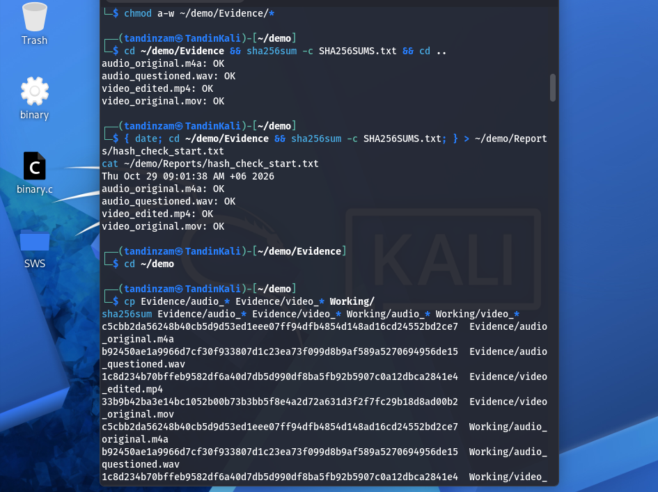
*Figure 1: Intake hashes verified and working copies made*

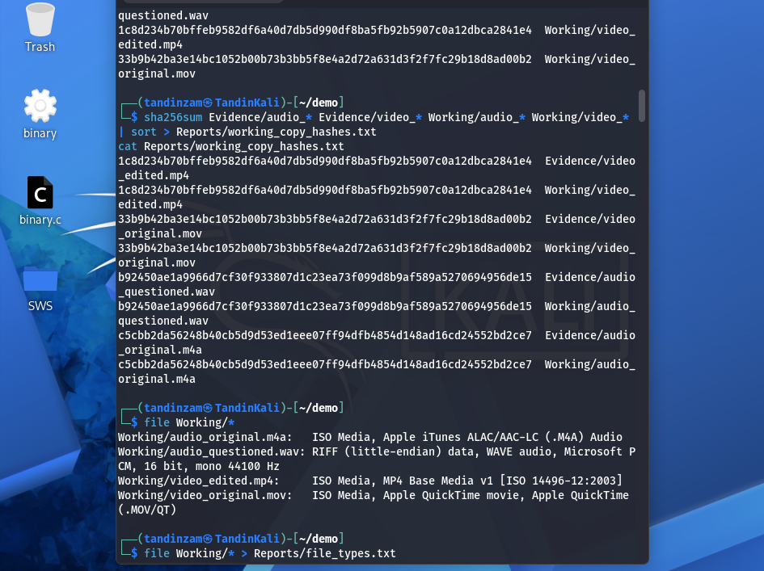
*Figure 2: Real file types*

## 3. Part 2: Audio Analysis

### 3.1 Properties and metadata

```bash
ffprobe -v error -show_entries format=duration,bit_rate:stream=codec_name,sample_rate Working/audio_questioned.wav
exiftool -a -G1 Working/audio_questioned.wav
```

| Field | Original | Questioned |
| --- | --- | --- |
| Codec | AAC | PCM (WAV) |
| Sample rate | 48000 Hz | 44100 Hz |
| Duration | 16.62 s | 7.02 s |
| Software | Core Media Audio (iPhone 15) | Lavf60.16.100 (FFmpeg) |
| Comment | Recorded on iPhone 15 | Original recording - unedited |

A true copy cannot have a different sample rate and half the length. Lavf is a conversion tool, not a recorder, and the "unedited" comment is just a claim.

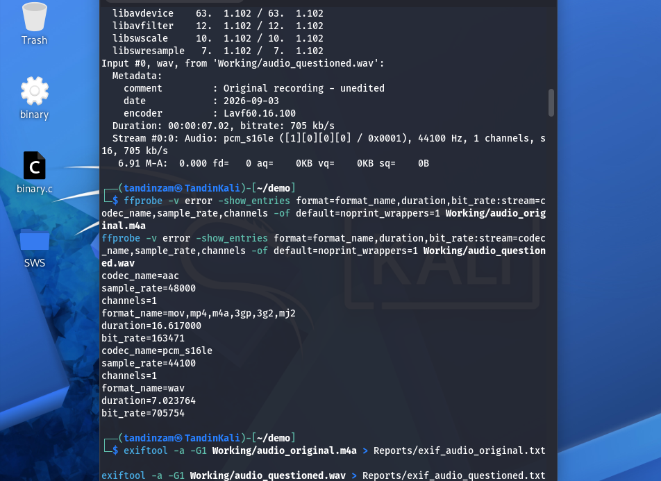
*Figure 3: Audio stream properties*

### 3.2 Spectrograms

```bash
sox Audio/questioned_work.wav -n spectrogram -x 1000 -z 90 -o Reports/spec_questioned.png
```

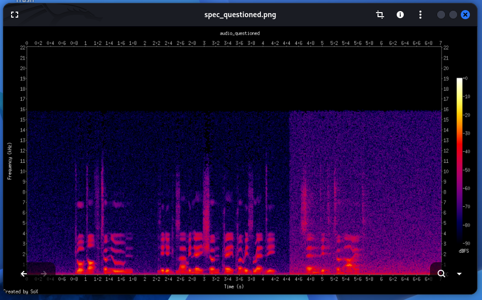
*Figure 4: Questioned audio, with a sudden background change at 4.44 s and nothing above 16 kHz*

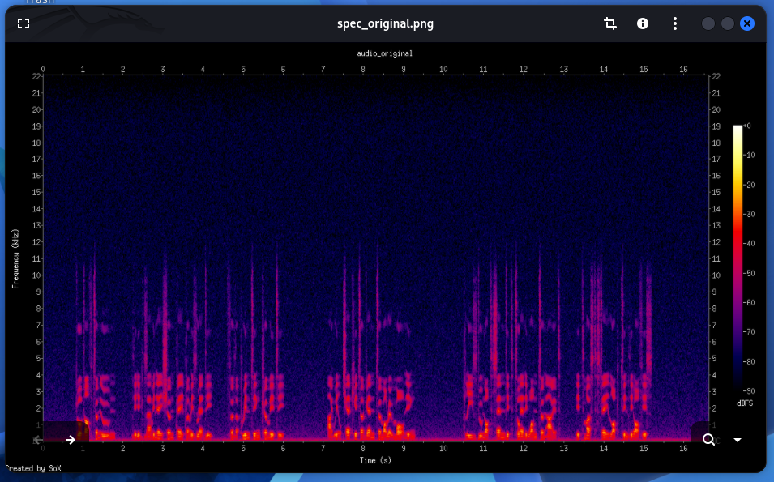
*Figure 5: Original audio, with an even background and content up to 22 kHz*

The straight vertical change at 4.44 s points to a join between two recordings. The flat cut-off at 16 kHz shows the WAV was converted from an MP3.

### 3.3 Noise floor and mains hum

```bash
sox Audio/questioned_work.wav -n trim 6.2 0.7 stat 2>&1 | grep "RMS     amp"
```

| Pause | Original | Questioned |
| --- | --- | --- |
| Before join (0.1 to 0.7 s) | -48.9 dBFS | -49.3 dBFS |
| After join (6.2 to 6.9 s) | -48.6 dBFS | -39.1 dBFS |

The questioned background got about 10 dB louder after the join. The 50 Hz hum also gets brighter at the same point, so the second part was recorded in a different place.

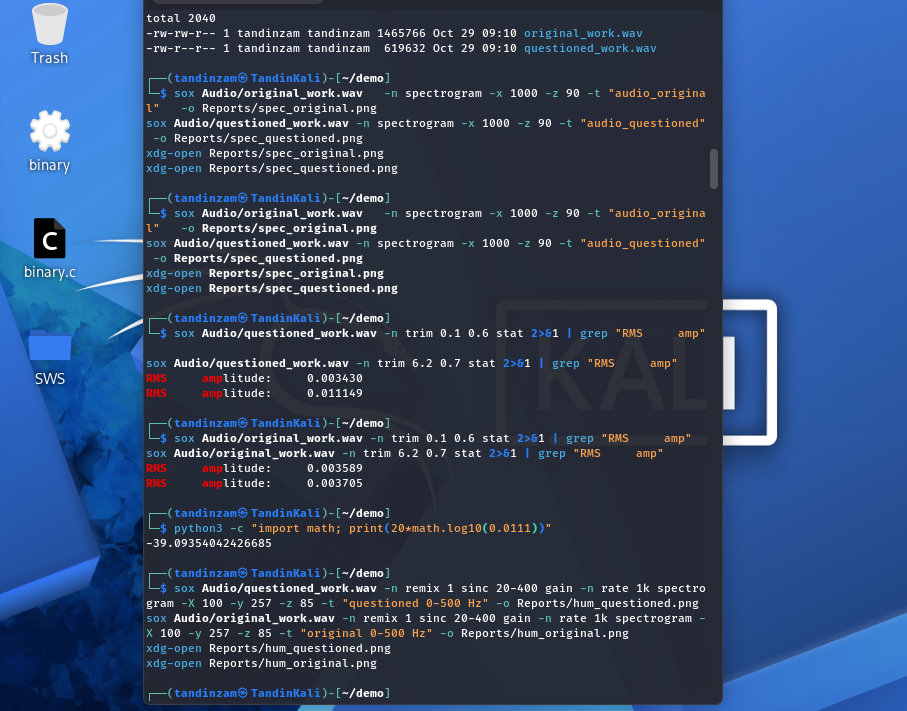
*Figure 6: RMS noise before and after the join*

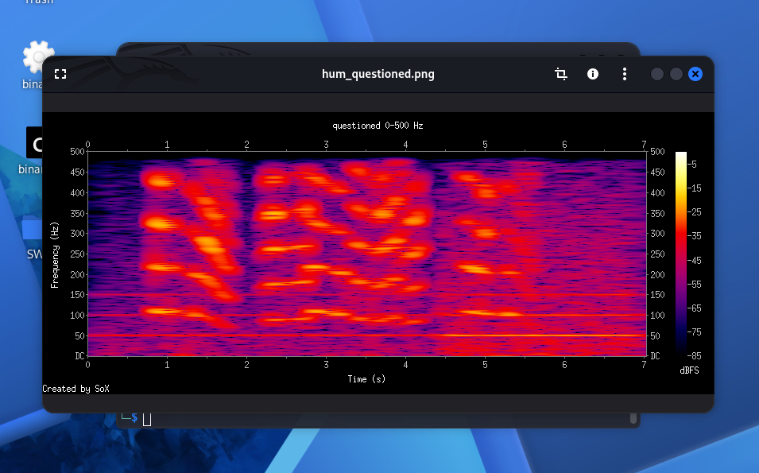
*Figure 7: 0 to 500 Hz view of the questioned audio, showing the 50 Hz hum getting stronger after 4.4 s*

### 3.4 Content comparison

In Audacity, the first 4.4 s match the original. "for the printing committee" was cut out, and "send it tonight" does not exist in the original (it says "Please do not send it to anyone tonight"), so the meaning was flipped.

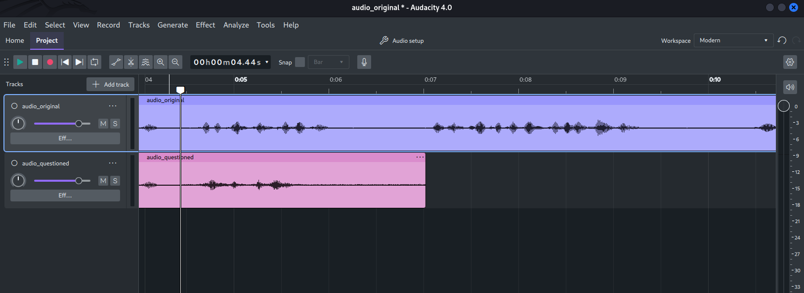
*Figure 8: Original (blue) and questioned (pink) tracks at 4.44 s*

> **[Screenshot placeholder: Audacity zoomed in on the join at 4.44 s]**

I also removed the hum from a copy with notch filters at 50, 100 and 150 Hz. The enhanced copy is only for clearer listening and is not evidence.

## 4. Part 3: Video Analysis

### 4.1 Properties and metadata

```bash
ffprobe -v error -show_entries format=duration,bit_rate:format_tags=creation_time,encoder:stream=nb_frames Working/video_edited.mp4
exiftool -Make -Model -GPSPosition -CreationDate -CompressorName Working/video_original.mov Working/video_edited.mp4
```

| Field | Original | Edited |
| --- | --- | --- |
| Duration / frames | 20.0 s / 600 | 16.0 s / 480 |
| Bit rate | 4,192 kb/s | 279 kb/s |
| Created | 2026-09-03 16:22:11 (+06) | 2026-09-05 02:41:07 UTC |
| Device | Apple iPhone 15 | none |
| GPS | 27°28'22" N, 89°38'20" E (Thimphu) | none |
| Encoder | H.264 (Apple) | Lavf / libx264 (FFmpeg) |

120 frames (4.0 s) are missing. The edited copy was made two days later by FFmpeg, and the device and GPS data were removed.

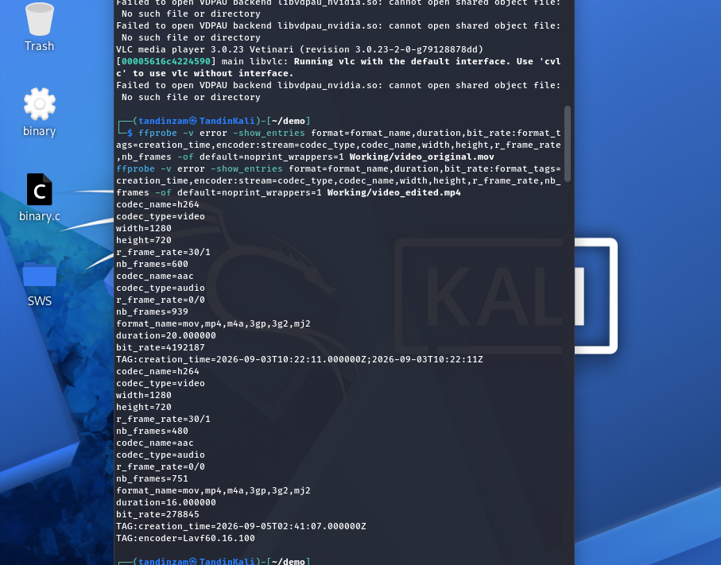
*Figure 9: Video stream properties*

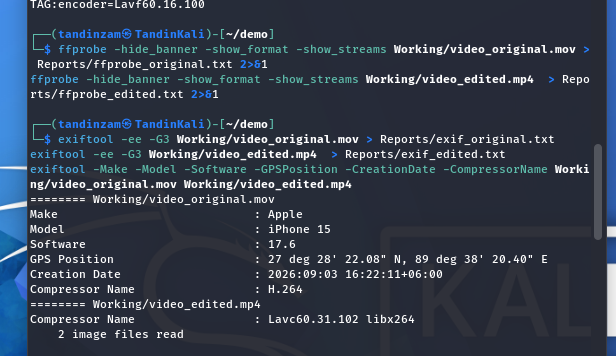
*Figure 10: Device, GPS and creation date*

### 4.2 GOP and frame hashes

```bash
grep -c I Reports/frames_edited.csv
ffmpeg -i Working/video_edited.mp4 -map 0:v -f framemd5 Reports/edited.md5
comm -12 Reports/h1.txt Reports/h2.txt | wc -l
```

The original has 20 I-frames (one per second), while the edited copy has only 2. None of its 480 frames match any of the original's 600 frames, so the whole video was re-encoded.

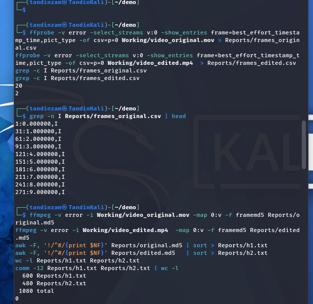
*Figure 11: I-frame count and frame hash comparison*

### 4.3 Finding the cut

```bash
ffmpeg -i Working/video_edited.mp4 -vf "select='between(n,269,270)',scale=640:-1,tile=2x1" -frames:v 1 Reports/cut_frames.png
```

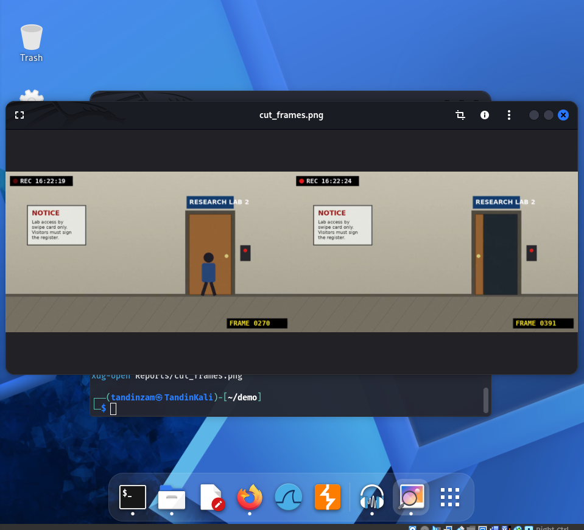
*Figure 12: Edited frames 270 and 271, where the counter jumps from 0270 to 0391 and the clock from 16:22:19 to 16:22:24*

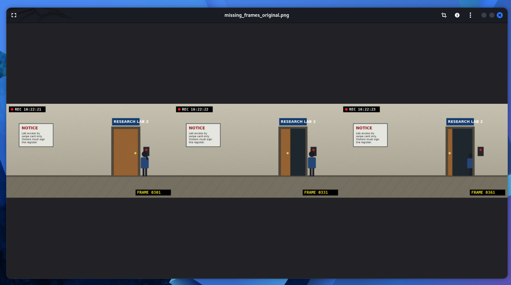
*Figure 13: Original frames 301, 331 and 361 from the removed part, showing the person swiping the card and entering Research Lab 2*

### 4.4 Soundtrack events

```bash
ffmpeg -i Working/video_original.mov -vn -acodec pcm_s16le Audio/video_original_audio.wav
sox Audio/video_original_audio.wav -n spectrogram -x 1000 -z 80 -o Reports/events_original.png
```

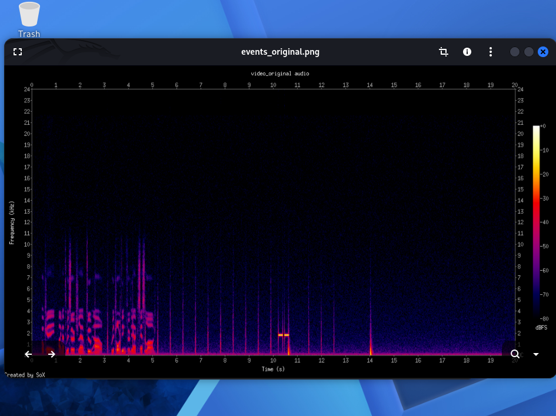
*Figure 14: Original soundtrack, with two card beeps at about 10.2 and 10.45 s and the door closing at 14.0 s*

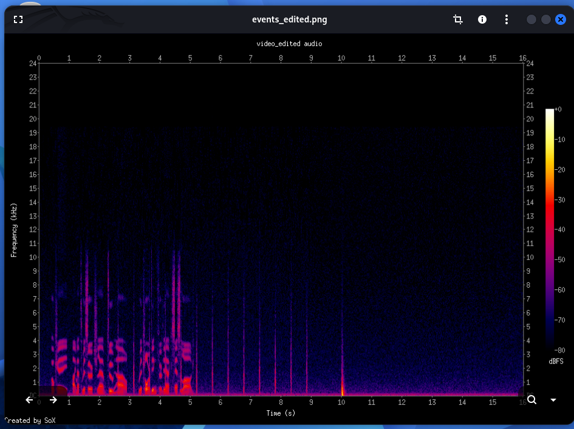
*Figure 15: Edited soundtrack, where the beeps are gone and the door closing is at 10.0 s*

The sound confirms the same 4 second cut.

## 5. Part 4: Final Check

```bash
sha256sum -c SHA256SUMS.txt
```

All four files were still OK at the end, so the analysis did not change the evidence.

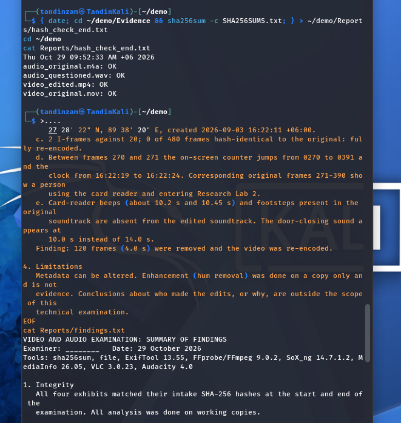
*Figure 16: Final hash check*

## 6. Findings

1. **Integrity:** all four exhibits matched their SHA-256 hashes at the start and end. All work was done on copies.
2. **Audio:** made by FFmpeg, not a recorder. It was converted from an MP3, and at 4.44 s the background rises by 10 dB and the hum changes. "send it tonight" is not in the original. **Indicators of editing were found at 4.44 s.**
3. **Video:** 120 frames (4.0 s) were removed between frames 270 and 271, hiding a person using the card reader and entering Research Lab 2. The video was fully re-encoded and its device and GPS metadata were removed.
4. **Limitations:** metadata can be altered, and who made the edits or why is outside the scope of this examination.

## 7. Conclusion

Neither questioned file is a faithful copy. Separate tests all pointed to the same place in each file. I learned that a matching hash only shows a file has not changed since it was collected, not that it is genuine, and that findings should be worded as "indicators of editing" rather than "proved fake".